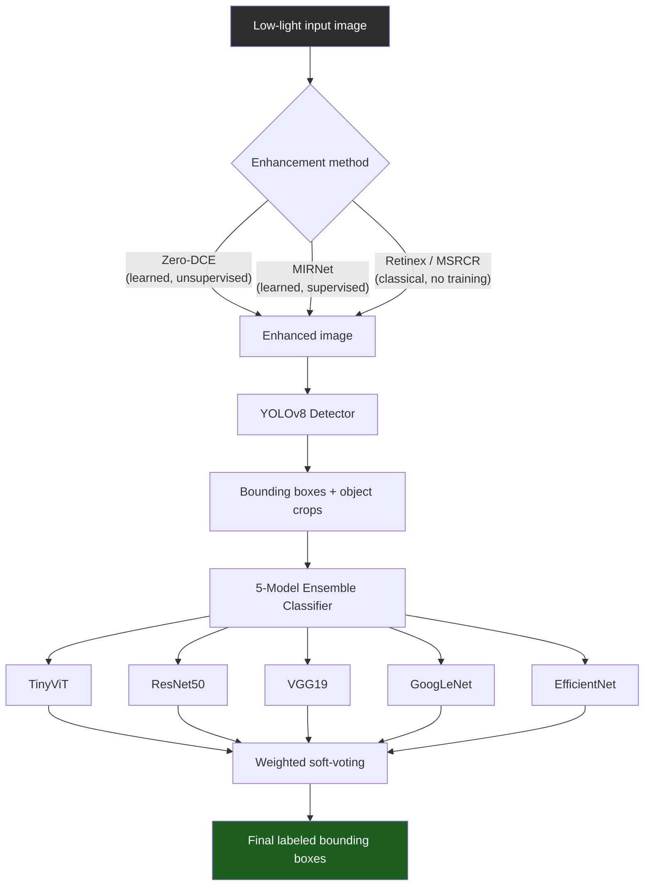

# Low-Light Object Detection & Classification Pipeline

[](https://www.python.org/)
[](https://pytorch.org/)
[](https://github.com/ultralytics/ultralytics)
[](#license)

An end-to-end pipeline for **detecting and classifying objects in low-light images**, combining learned/classical image enhancement, YOLOv8 detection, and a 5-model ensemble classifier.

---

## Table of Contents

- [Overview](#overview)
- [Pipeline Architecture](#pipeline-architecture)
- [Project Structure](#project-structure)
- [Setup](#setup)
- [Usage](#usage)
  - [0. Prepare Data](#0-prepare-data)
  - [1. Train the Enhancement Model](#1-train-the-enhancement-model)
  - [2. Train the YOLOv8 Detector](#2-train-the-yolov8-detector)
  - [3. Train the Ensemble Classifier](#3-train-the-ensemble-classifier)
  - [4. Run the Full Pipeline](#4-run-the-full-pipeline)
  - [5. Evaluate](#5-evaluate)
- [Notes for Report / Write-up](#notes-for-report--write-up)
- [License](#license)

---

## Overview

Standard object detectors and classifiers degrade sharply on low-light images due to poor contrast, sensor noise, and loss of fine detail. This project addresses that with a **three-stage pipeline**:

1. **Enhancement** — brightens/denoises the image before anything else sees it (choice of 3 methods)
2. **Detection** — YOLOv8 locates objects in the enhanced image
3. **Classification** — a 5-backbone ensemble classifies each detected crop

## Pipeline Architecture



## Project Structure

```
low_vision_classifier/
├── data_prep/
│   ├── convert_exdark_to_yolo.py    # ExDark annotations → YOLO format
│   ├── synthetic_darken.py          # Darkens any bright dataset (gamma + noise)
│   └── extract_crops_from_yolo.py   # Auto-builds classification dataset from detection boxes
├── enhancement/
│   ├── zero_dce.py                  # Zero-DCE model + unsupervised loss functions
│   ├── mirnet.py                    # Simplified MIRNet (multi-scale residual, supervised)
│   ├── retinex.py                   # Classical MSRCR / SSR (no training needed)
│   └── train_enhancement.py         # Trains Zero-DCE or MIRNet
├── detection/
│   └── yolov8_detector.py           # Train / eval / run YOLOv8 (ultralytics wrapper)
├── classification/
│   ├── ensemble_model.py            # 5-backbone ensemble + soft-voting + optional stacking head
│   └── train_ensemble.py            # Trains the ensemble on cropped object images
├── pipeline.py                      # Full inference: raw image → enhance → detect → classify
├── evaluate.py                      # mAP for detection, accuracy/F1/confusion matrix for classification
└── requirements.txt
```

> **Note:** file paths above reflect the intended repo layout. If you're pushing the flat set of scripts as-is, either move them into these subfolders or update the `sys.path.append(...)` lines in `pipeline.py` / `evaluate.py` to match wherever you place them.

## Setup

```bash
git clone https://github.com/<your-username>/<your-repo>.git
cd <your-repo>
pip install -r requirements.txt
```

**Requirements:** Python 3.9+, a CUDA-capable GPU recommended for training (CPU works for inference on single images).

## Usage

### 0. Prepare Data

You need real or synthetic low-light data before training anything.

**Path A — Real low-light data (recommended):**

1. Download [ExDark](https://github.com/cs-chan/Exclusively-Dark-Image-Dataset) (7,363 low-light images, 12 classes, bounding boxes) and the [LOL dataset](https://daooshee.github.io/BMVC2018website/) (500 paired low/normal-light images, for MIRNet).
2. Convert ExDark annotations to YOLO format:
   ```bash
   cd data_prep
   python convert_exdark_to_yolo.py \
       --images_dir /path/to/ExDark --annotations_dir /path/to/ExDark_Annno \
       --output_dir ../data/exdark_yolo --val_split 0.15
   ```
3. Auto-generate the classification dataset from those same labels:
   ```bash
   python extract_crops_from_yolo.py \
       --yolo_dir ../data/exdark_yolo --output_dir ../data/classification \
       --class_names Bicycle Boat Bottle Bus Car Cat Chair Cup Dog Motorbike People Table
   ```

**Path B — Synthetic low-light data:**

Darken any normal-light labeled dataset (COCO, VOC, or your own) so existing labels stay valid:

```bash
cd data_prep

# Paired mode → for MIRNet training (keeps dark + original as ground truth)
python synthetic_darken.py --input_dir ./data/bright_images --output_dir ./data/synthetic_low \
    --mode pairs --gamma_range 2.0 3.5 --noise_std 0.02

# Darken-only mode → for detection/classification, preserves folder structure
python synthetic_darken.py --input_dir ./data/coco_bright --output_dir ./data/coco_dark \
    --mode darken_only --gamma_range 1.8 3.0
```

This is a legitimate, widely-used technique in low-light CV literature when real paired/annotated dark data is scarce — worth mentioning explicitly in your report if you use it.

### 1. Train the Enhancement Model

Zero-DCE (no ground-truth pairs needed):
```bash
cd enhancement
python train_enhancement.py --model zero_dce --data_dir ./data/lowlight_only --epochs 100
```

MIRNet (needs paired low/high-light images, e.g. LOL dataset):
```bash
python train_enhancement.py --model mirnet --low_dir ./data/LOL/low --high_dir ./data/LOL/high --epochs 100
```

Retinex (`retinex.py`) needs no training — useful as a fast classical baseline.

### 2. Train the YOLOv8 Detector

```bash
cd detection
python yolov8_detector.py train --data_yaml ./data/data.yaml --epochs 100 --model_size yolov8n.pt
python yolov8_detector.py eval --weights runs/detect/low_vision_yolov8/weights/best.pt --data_yaml ./data/data.yaml
```

### 3. Train the Ensemble Classifier

```bash
cd classification
python train_ensemble.py --data_dir ./data/classification --epochs 30 --batch_size 32
```

Use `--models resnet50,vgg19` to train a subset instead of all 5 if compute-limited.

### 4. Run the Full Pipeline

```bash
python pipeline.py \
  --image sample_dark_photo.jpg \
  --enhance_method zero_dce --enhance_weights checkpoints/zero_dce_final.pt \
  --yolo_weights checkpoints/yolov8_best.pt \
  --ensemble_weights checkpoints/ensemble_best.pt \
  --output_dir ./outputs
```

Produces `enhanced.jpg`, per-object `crops/`, and an annotated `result.jpg` with boxes + labels.

### 5. Evaluate

```bash
python evaluate.py detection --weights checkpoints/yolov8_best.pt --data_yaml data/data.yaml
python evaluate.py classification --weights checkpoints/ensemble_best.pt --data_dir data/classification
```

The classification evaluator also prints **per-backbone accuracy** alongside the ensemble accuracy, so you can quantify how much ensembling actually helps.

## Notes for Report / Write-up

- **mAP** is a detection metric (YOLOv8 box predictions). If reporting a single mAP number for the *classification* ensemble, double check that's intentional — classification results are normally reported as accuracy / F1, not mAP.
- All classifiers are pretrained on ImageNet and fine-tuned on the cropped-object dataset (transfer learning) — standard practice and much faster to converge than training from scratch.
- The ensemble uses **learnable soft-voting weights** (a per-backbone parameter, softmax-normalized) rather than a fixed 1/5 average, so it learns to trust stronger backbones more. An optional `StackingHead` (MLP on concatenated logits) is included in `ensemble_model.py` for a stronger ablation if you want to push accuracy further.

## License

Add a license (e.g. MIT) if you intend this to be reusable — GitHub can generate one automatically when creating the repo, or add a `LICENSE` file manually.